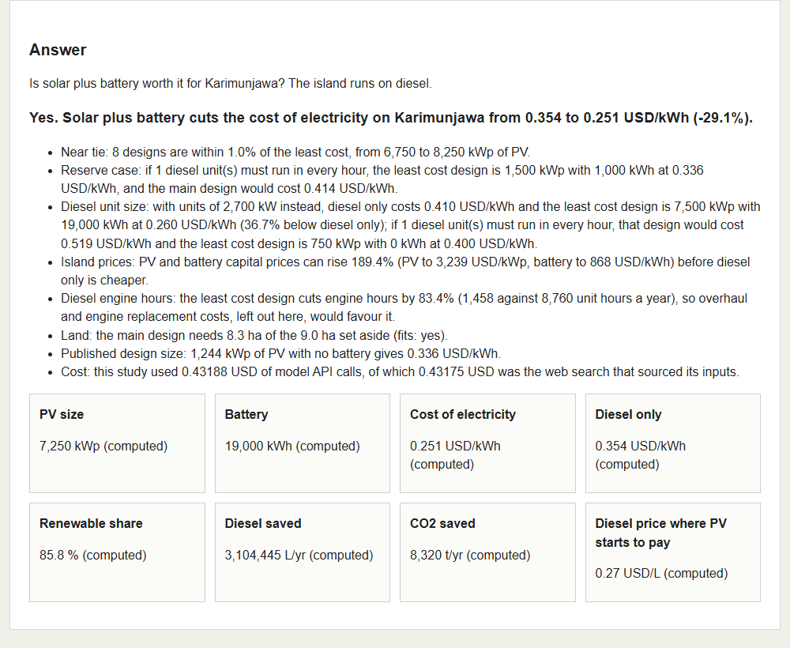
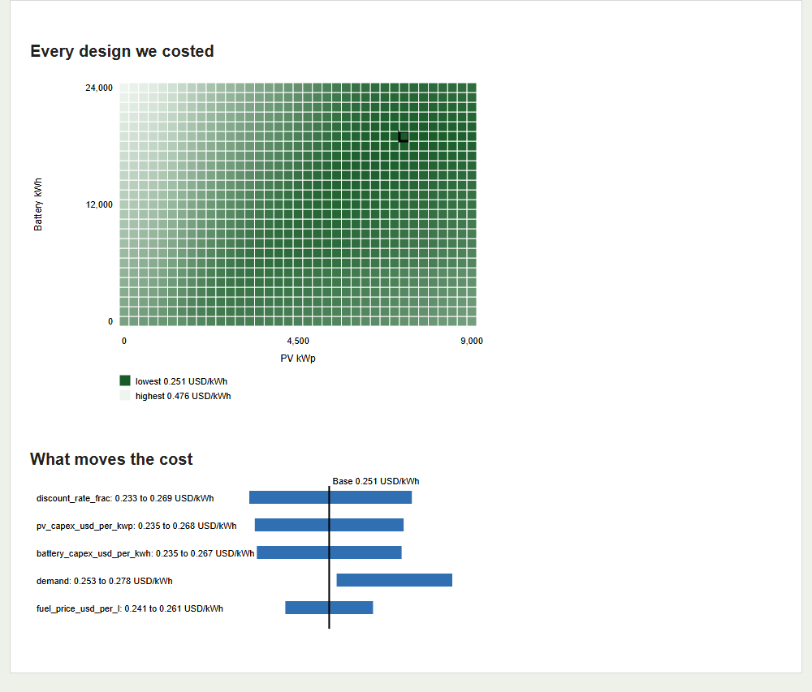
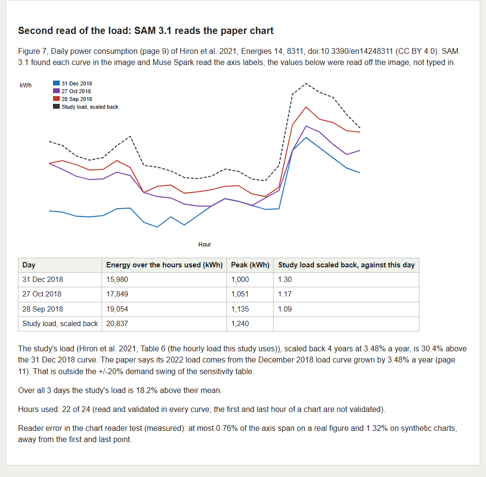
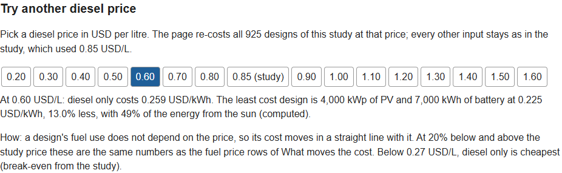
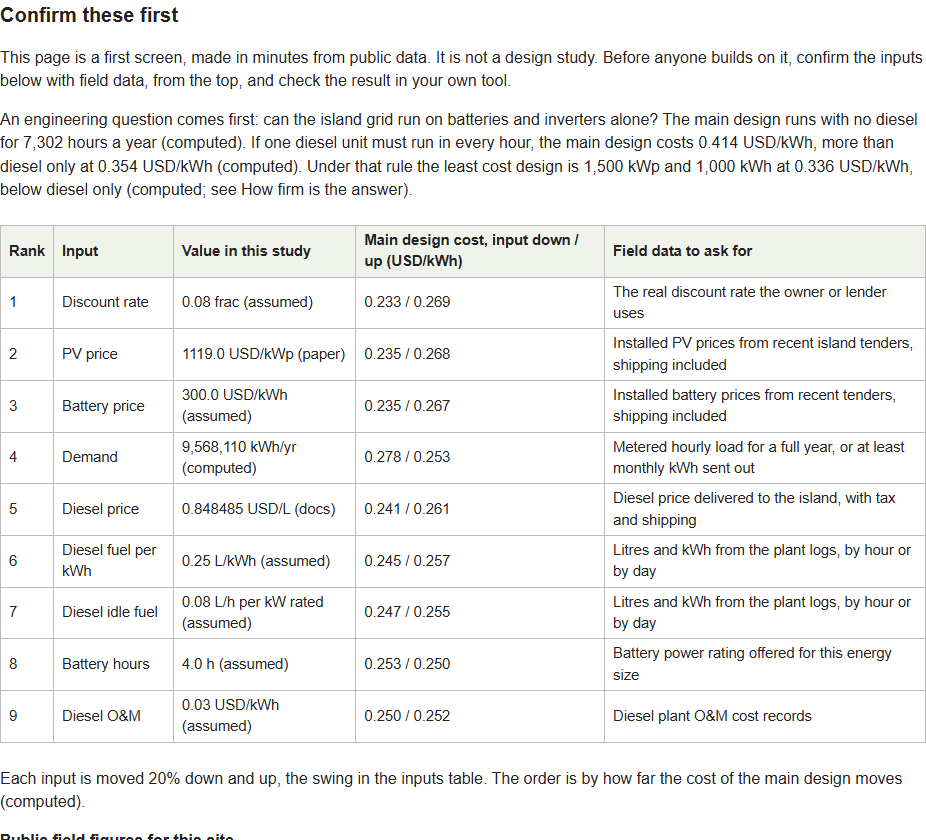
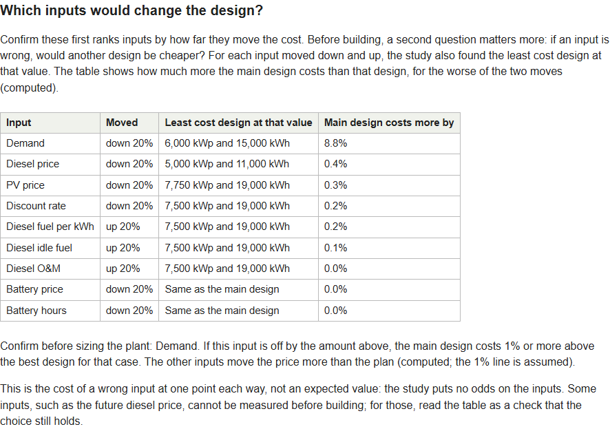
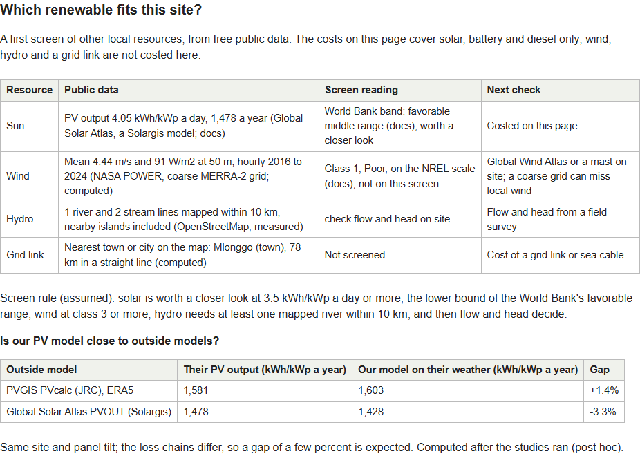
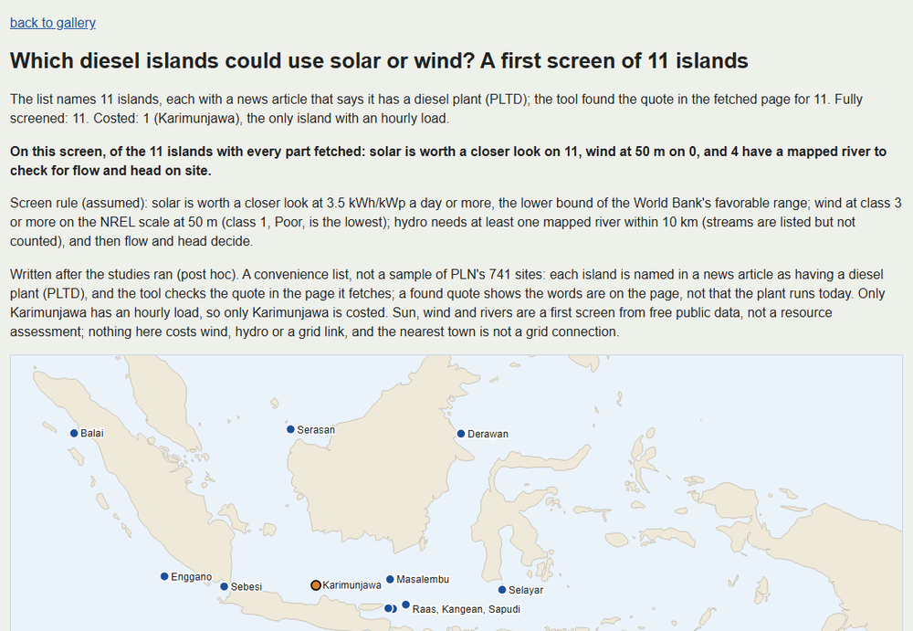
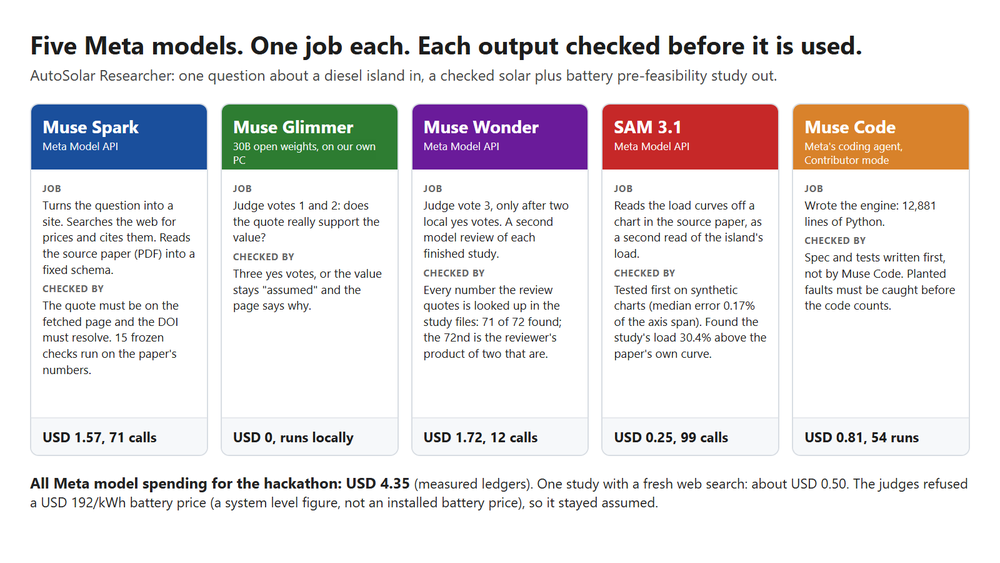

# AutoSolar Researcher

Ask one question about an island that runs on diesel. Get back a checked solar plus battery pre-feasibility study:
weather from four sources, an hourly simulation of PV, battery and diesel for every design on a grid, the cost of
electricity (levelized, LCOE), the fuel and CO2 saved, cited cost inputs, a check of the published study for the same island, a
second model's review, and a plain list of what the study does not cover.

Indonesia's state utility PLN plans to replace 2,396 diesel generators at 741 sites with solar and batteries (press,
[Bloomberg Technoz](https://www.bloombergtechnoz.com/detail-news/105965/pln-bakal-ganti-2-396-pltd-dengan-plts-3-21-gwp-bess-9-03-gwh)).
Each site needs a first study like this before anyone spends money on a detailed one. Today the tool costs one
island, Karimunjawa, the only one with an hourly load, and screens 11. It is a first screen, not
a replacement for a detailed design in PVsyst or HOMER: each latest study page says which inputs to confirm first
and gives the hourly series behind the answer, so an engineer can set up the same case in such a tool and compare.

Live study pages: https://havidaqoma.github.io/autosolar-researcher/site/

Demo video (2 min 55 s; press CC for subtitles): https://www.youtube.com/watch?v=8xA9nRxLLtA

Problem statement: Push the Frontier (energy). Built during the Meta Global AI Developer Hackathon; what was
prepared before kickoff is listed in `PRE_EVENT.md`. "Post hoc" below means added after the first study's results,
still during the hackathon.

In short, for Karimunjawa (computed unless labelled; percentages come from unrounded costs, so they can differ by
0.1 from the rounded prices shown):

| | The answer: example study (inputs fixed before the run) | What-if, not the answer: 7 inputs curated by hand (post hoc) |
|---|---|---|
| Diesel only | 0.354 USD/kWh | 0.511 USD/kWh |
| Least cost solar plus battery | 7,250 kWp and 19,000 kWh at 0.251 USD/kWh, 29.1% less | 8,500 kWp and 19,000 kWh at 0.277 USD/kWh, 45.7% less |
| Battery prices and discount rate | assumed | from named documents |
| If one diesel unit must always run | a smaller design (1,500 kWp) is still 5.1% below diesel only | a smaller design (4,250 kWp) is still 9.9% below |
| How far PV and battery prices could rise before diesel only is cheaper | 189% (to 3,239 USD/kWp and 868 USD/kWh) | 365% (to 5,199 USD/kWp and 1,812 USD/kWh) |

So with every input fixed before the run, solar plus battery is 29.1% cheaper than diesel only. The 45.7% in the
second column is a post hoc what-if (7 inputs curated by hand after the run), not the answer. The gap is much
smaller if a diesel unit must always spin. The load comes from the island's one published study, and our own chart check puts it
about 30% above the paper's December 2018 curve (18% above the mean of the three days it plots); at the load that
curve implies, solar plus battery is still 33.7% cheaper (post hoc). The metered load comes first: of the 9
inputs it is the only one whose error would move the best plant enough to matter, past the page's 1% line
(computed; the line is assumed). Pages: `docs/site/b4a44fc6d4c32339.html`
(example) and `docs/site/107477f112e5d92c.html` (curated).

What two people in the field told us (wording approved by each of them; they speak for themselves, not for
their employers):

> "Planning PV plus battery for a site usually takes one to six months, with PVsyst and other tools, so that nothing
> fails. An AI study in minutes is impressive, but every number must be double checked against references or field
> data, and the report must be easy to read and the data trustworthy."
>
> A senior engineer at PLN (Perusahaan Listrik Negara, Indonesia's state-owned electricity company), speaking for
> himself, not for PLN

> "A model that does this study in minutes is very impressive. A solar plus battery against diesel study can be done
> by a person, only slower. Screening every resource for a site, sun, wind, hydro and distance, is harder for a
> person, so that is where a tool like this adds most."
>
> Dr. Andy Tirta, Head of Corporate Affairs, ASEAN Centre for Energy, speaking for himself

What we built after these talks (post hoc): "Confirm these first" on the latest study pages (the inputs to check
first, the field data to ask for, the hourly series and a HOMER load file), and "Which renewable fits this
site?" (sun, wind, rivers and distance), also run as a screen of 11 islands.

## For judges

The short version (computed unless labelled):

- The answer: for Karimunjawa, with every input fixed before the run, solar plus battery costs 0.251 USD/kWh
  against 0.354 for diesel only, 29.1% less (page `docs/site/b4a44fc6d4c32339.html`).
- Where it gets close, on the same page: if one diesel unit must always run, the main design costs 0.414 USD/kWh,
  more than diesel only; a smaller design (1,500 kWp and 1,000 kWh) still beats diesel only, 0.336 against 0.354
  USD/kWh, 5.1% less. Our own read of the paper's load chart puts the load about 30% above the paper's December
  2018 curve; at the load that curve implies, solar plus battery is still 33.7% cheaper (post hoc).
- What to measure first: the load. With 20% less load a smaller plant is best (6,000 kWp and 15,000 kWh) and our
  design would cost 8.8% more than it. Other inputs, moved 20% either way, can change the cheapest design too
  (with 20% cheaper diesel it is 5,000 kWp and 11,000 kWh), but ours then costs at most 0.4% more than it, because
  the cost changes little between those designs (the page draws the line at 1%, assumed; computed). So the metered
  load comes before any price, and the plant size stays provisional until the load is measured.
- What the checks turned down: a battery price of 192 USD/kWh (the number is in its quote, so the script let it
  through; the judges said no, because the quote gives a whole storage system's cost, not the battery price), a battery upkeep
  cost outside the allowed range (50 USD/kWh/yr against 0.5 to 30), and any site more than 30 km from Karimunjawa, a fixed cut-off (assumed) (Bawean, 247 km away: "No
  study").
- What a small error does (post hoc twin test, "Twin test" under Checks): 10 cited values were given to the
  checker again with the number moved by 1%, 10% and 30%, down and up. The script stopped all 60 wrong copies, and the local
  judge alone said no to all 60 too, even at 1%. It also turned down 2 of the 10 true values, on how the quote
  describes the input, not on the number (computed). Here the quote still holds the true number, so a moved number
  is easy to spot; the 192 USD/kWh case above is the kind only the judges catch.
- Meta models, each with a fixed job, and a check on every output before it is used: Muse Spark turns the question
  into a site, searches the web for cost inputs and reads the paper; Muse Glimmer (open weights, on our own PC)
  and Muse Wonder judge each cited value; Muse Wonder also reviews the report; SAM 3.1 reads the paper's load
  chart; Muse Code wrote the engine to specs and tests written first. All Meta model spending: USD 4.35
  (measured ledgers).
- Check us without an API key: `uv sync`, then `uv run pytest` (1,902 tests, no network), then
  `uv run python tools/twin_test.py --out runs/twin_check` (the quote check half of the twin test: no model call, no network), and
  open `docs/site/index.html`. A fresh clone passed every test (measured, `docs/smoke/CLONE_TEST.md`), and a
  re-run into an empty folder, reusing the saved weather and web search, gave the same run hash (measured,
  `docs/smoke/FRESH_RERUN.md`).

What it cost (measured ledgers): Muse Code wrote the engine, all 12,881 lines of `autosolar/` (25 files, `wc -l`),
for USD 0.81. There are two reasons it was that cheap. It ran in Contributor mode, which Meta prices lower in
exchange for permission to use what is sent to train future Meta models (docs, Meta pricing page). And 93% of the
72 million tokens it read were cache hits, which cost 2% of a fresh token (docs). Without the cache it would
have cost about USD 7.40 at the same prices (computed). It did not write the specs or the tests: each task's spec and acceptance tests were written first,
and Muse Code wrote code until they passed (the git history shows the order). Specs, tests, the other run tools and the 7 hand-picked values were written with a general AI coding assistant (not a Meta model), directed and checked by Havid. One full study, with a fresh web
search for its prices, costs about USD 0.50 in Meta model calls (the example study: USD 0.43, almost all of it the
web search, plus USD 0.085 for the two-model re-check; a run that reuses a search costs much less). The paper
check, load check and second model review add about USD 0.25 to 0.35 (measured). All Meta model spending for the whole hackathon,
smoke tests, chart reader tests and reviews included: USD 4.35.

## Details for judges

- Scope: one island today. The only hourly load the tool has is Karimunjawa's (from the published study), so it
  answers for sites within 30 km of it and refuses other sites rather than guess. The 30 km cut-off is a fixed
  rule (assumed), and a site inside it still gets Karimunjawa's load, so its answer is only as good as that
  guess. A new site needs its own hourly
  load. Asked about Bawean, another diesel
  island in the Java Sea, it answers "No study" and says the site is 247 km away (computed,
  `docs/smoke/T19_SMOKE_RULES.md`).
- Try it on the page: each study page has "Try another diesel price". Click a price from 0.20 to 1.60 USD/L
  and the page shows the least cost design at that price, re-costed over all 925 designs (computed). Every price's
  answer is worked out when the page is built, so the click only shows it and the page needs no JavaScript. It
  is an exact re-cost within the model, not a guess between points: a design's fuel
  use does not depend on the price, and at 20% below and above the study price it gives the same numbers as
  the sensitivity table.
- Confirm these first (latest study pages): the 9 main inputs ranked by how far each moves the cost of the main design,
  each with the field data to ask for (in the example the discount rate comes first). Next to them, public field
  figures from the press, each with its quote: in 2017, less than a year after 24 hour power began (May 2016, same
  article), the island's plant produced 8,000 kWh a day on 4,000 L of diesel (press, Kompas; it may be the main
  plant only, as the article also names two small rented units). The study's load is 3.28 times that, or 2.76
  times once the 2017 figure is grown at the paper's 3.48% a year to the study year (computed). The paper's own
  three days of 2018, as SAM 3.1 reads them, are 2.2 to 2.6 times the press figure (computed), so the public
  sources disagree with each other too. The study's diesel uses 0.382 L/kWh, idle fuel included, against 0.50 in
  the press, at a different load and plant mix (computed). The study does not use these figures; a load that much
  lower is outside what it tested (the sensitivity table goes to 20% lower, the post hoc chart case to 23.3%
  lower), so the metered load is the first thing to get. Then
  two hourly files to check us in your own tool: `hourly.csv` (8,760 hours of weather, load, PV and the main
  design's energy flow) and the load as one column for HOMER. Before writing them, the tool must give back the
  study's yearly numbers from them, a self check that they are the study's own series (it did, to within one part
  in a billion, computed; `docs/specs/T22_confirm_first.md`). An engineer can set up the same case in their own
  tool and compare; we have not run PVsyst or HOMER ourselves.
- Which inputs would change the design (latest study pages, `docs/specs/T26_design_change.md`): for each input
  moved 20% down and up, the page shows the least cost design at that value and how much more the main design
  costs than it (computed from the study's own sensitivity rows; no new simulation). A wide cost swing does not
  mean the choice changes. In the example only the load moves it past the page's 1% line (assumed): with 20% less
  load the best design is 6,000 kWp and 15,000 kWh, and the main design costs 8.8% more than it. For other inputs
  the best design at that value can differ a lot (with 20% cheaper diesel it is 5,000 kWp and 11,000 kWh), but the
  cost changes little between those designs, so the main design is at most 0.4% above it (computed). So the metered load comes before any price.
- Which renewable fits this site (post hoc, `docs/specs/T23_resource_screen.md`): sun 4.05 kWh/kWp a day (Global
  Solar Atlas, a Solargis model), the World Bank's favorable middle range; wind 4.44 m/s and 91 W/m2 at 50 m (NASA
  POWER, hourly 2016 to 2024, computed), class 1 (Poor) on the NREL scale, though a coarse grid can miss local
  wind; 1 river and 2 streams mapped within 10 km, nearby islands included (OpenStreetMap); the nearest town on the
  map is 78 km away. Only solar, battery and
  diesel are costed. The same section has a sanity check of our PV model (one site, post hoc, not a validation):
  +1.4% against PVGIS and -3.3% against Global Solar Atlas (Solargis), computed. No Meta model call (the API ledger stayed at 179 lines during the run,
  measured).
- Eleven diesel islands at once (post hoc, `docs/specs/T24_island_screen.md`, page `docs/site/islands.html`): the
  same screen for 11 islands, each named in a news article as having a diesel plant (PLTD). The tool fetches each
  article and must find the quote in it (11 of 11 found; a found quote shows the words are on the page, not that
  the plant runs today). On this first screen, solar is worth a closer look on
  all 11 (3.59 to 4.50 kWh/kWp a day, Global Solar Atlas), wind at 50 m passes on none (all class 1, 2.82 to 5.64 m/s,
  NASA POWER, computed; a coarse grid can miss local wind, so this does not rule wind out), and 4 have a mapped river within 10 km (OpenStreetMap). Only Karimunjawa is costed: it is
  the only island with an hourly load, and the page says so for every other row. The list is a convenience list
  found by searching the news, not a sample of PLN's 741 sites. The Karimunjawa row gives back the values of the
  single site screen above. The first run (1,151 s) lost two river lookups to map server timeouts and said so; a
  second run fetched only those two (69 s), and a third, from the cache with no network, gave the same rows
  (a script compared the saved records). An outside review of the page (DeepSeek) asked for the screen's
  cut-offs on the page, 'having' rather than 'running' a diesel plant, and straight-line town distances; all six
  points were fixed (T24c). The map first drew a coarse land outline that left out 7 of the 11 islands, so their
  dots sat on open sea; it now uses a finer outline (Natural Earth 1:10m), rings instead of filled dots, and a
  link from each island to its point on OpenStreetMap; 2 islands are still too small to draw and the page names
  them (T24d). No Meta model call.
- When the checks say no (example study page, Inputs table): the judge refused a battery price of USD 192/kWh,
  because the quote gives a system level storage cost, not the installed price of a lithium-ion battery; the
  range check threw out a battery upkeep cost of 50 USD/kWh/yr before any vote, as outside the allowed 0.5 to
  30; when a site blocked the download (HTTP 403), the tool searched a second time. A value that fails keeps its assumed value and the page
  says why: 3 of the 7 sourced inputs stayed assumed (these two, and the discount rate, where both downloads
  failed).
- If the load chart is right (post hoc): the load check finds the study's load 30.4% above the paper's
  December 2018 curve (18.2% above the mean of the three days it plots). At the load that curve implies (23.3%
  lower, computed), solar plus battery still wins: 5,750 kWp and 15,000 kWh at 0.257 USD/kWh against 0.388 for
  diesel only, 33.7% less (computed). Before it reports, the tool must give back the study's own numbers; the
  rules for this re-run were committed before it ran (`docs/smoke/T20_T21_SMOKE_RULES.md`).
- Built during the event: all code in `autosolar/`, `tools/` and `tests/`, every spec in `docs/specs/`, every study
  and the static site. `PRE_EVENT.md` lists what was prepared before kickoff (plan, literature sweep, hand audit of the
  paper, the 15 paper check rules as text, the second test paper, a weather cross check, satellite test images,
  Glimmer speed test), with commit times. The code that runs the paper checks was written during the event.
- Without cloning: the first seven pictures below are from the example study, the eighth is the island screen and
  the last shows the five Meta models. With a
  clone, open `docs/site/index.html`.



















- Meta tools, when each runs and how its output is checked:

| Tool | Job | When it runs | How its output is checked |
|---|---|---|---|
| Muse Spark (Meta Model API, model muse-spark-1.3-contributor) | Turns the question into a site; searches the web for cost inputs and cites them; reads the whole source paper as a PDF and returns its numbers as JSON bound by a schema | Every study | A quote must be found in the fetched page or PDF text, a DOI must resolve, then 15 frozen paper checks run on the numbers |
| Muse Glimmer (open weights, 30B Q4_K_M, 15.6 GiB, with llama.cpp on our own PC: a 16 GB GPU holds most of it and llama.cpp keeps the rest in system memory, measured) | Judge: does the quote support the value? | Every new search and every re-check: votes 1 and 2 | A value is "checked" only with 3 yes votes; otherwise it stays assumed and the report says why |
| Muse Wonder (Meta Model API) | Judge vote 3, and a second model review of the finished report | Vote 3 in every new search (`tools/source.py`, the default since T19) and in the re-check (`tools/rejudge.py --panel`), only after Glimmer said yes twice; the review runs after a study. Every checked input in the example study b4a44fc6d4c32339 passed this panel; the curated run starts from the same file | Every number the review quotes is looked up in the study files (71 of 72 in the latest review, of the example study; the 72nd is the reviewer's product of two numbers that are in the files, 249 cycles a year x 12 years) |
| SAM 3.1 (Meta Model API) | Reads values off chart images: here, Figure 7 of the source paper (three measured days of load), as a second read of the load the study uses | Once per figure (4 SAM calls and 1 Muse Spark label call, USD 0.01, measured); the latest study pages show the result | Rules fixed before each run. The reader test failed first, then passed (see "Chart reader"). The load check found the study's load 30.4% above the paper's own December 2018 curve (computed) |
| Muse Code (Meta's coding agent, Contributor mode, model muse-spark-1.3-contributor) | Wrote the engine (`autosolar/`) and some run tools from short specs | Build time | Each spec and its acceptance tests are written before the code, and the tests are checked to catch planted faults (last four tasks, final counts: 14 of 14, 15 of 16, 9 of 9 and 17 of 17; in the first two, one test was added after the code; T25's one remaining change keeps a negative zero, which the spec does not ask to remove and which prints the same; computed) |

- Checks: 1,902 unit tests with no network, and a fresh clone passes all of them (measured, `docs/smoke/CLONE_TEST.md`).
  Re-run into an empty folder (weather and web search read from disk), the example study gives the same run hash
  and byte-identical tables (measured,
  `docs/smoke/FRESH_RERUN.md`).
  Eleven gates run on every study (G3 runs once for each of the 4 weather sources). What the study cannot source stays
  "assumed", and the page says so.
- Cost: Muse Code USD 0.81 (54 runs, 5.7 hours; it read 72 million tokens, 93% from cache, and wrote 0.89
  million; Contributor mode prices, docs). Meta Model API USD 3.54 (182 calls, 451 web searches). USD 4.35 in
  all (measured ledgers).
- Limits: see "What it does not cover" (a what-if table there costs six of the left-out items, post hoc) and the
  open review points under "Checks".

## See it

Demo video (2 min 55 s): https://www.youtube.com/watch?v=8xA9nRxLLtA

The same pages are live at https://havidaqoma.github.io/autosolar-researcher/site/ (GitHub Pages). Or open `docs/site/index.html` in a browser (no server, no script, no internet needed). The example study is
`docs/site/b4a44fc6d4c32339.html`; the run with curated inputs (post hoc) is `docs/site/107477f112e5d92c.html`. Each
has a Muse Wonder review, and the gallery lists these two first. Both start from the input file whose 4 checked values were re-judged by two models
(see Checks; the curated run then replaces 7 values by hand, the diesel price among them). These two are the
entry. Earlier builds of the same two studies stay in the gallery with the same numbers, except that "What moves the
cost" now has 9 inputs and the curated diesel unit size check no longer sits on the grid edge (computed, a script
compared every fact, gate and table row). Raw run files are under `docs/site/data/`.

## The Karimunjawa answer (example study b4a44fc6d4c32339; computed unless labelled)

"Computed" says where a number comes from: the code calculated it from the inputs. It is only as good as those
inputs, and many of them are assumed, among them all battery prices, the discount rate and the diesel fuel curve.
The "Inputs" table on each page labels every one, and "What moves the cost" shows how much 9 of them matter.

| | |
|---|---|
| Answer | Yes. Solar plus battery cuts the cost of electricity from 0.354 to 0.251 USD/kWh (-29.1%). With the larger diesel units the source paper also prints, the cut is from 0.410 to 0.260 USD/kWh (-36.7%) |
| Least cost design | 7,250 kWp of PV and 19,000 kWh of battery, 85.8% renewable, 3,104,445 litres of diesel saved a year |
| Near tie | 8 designs are within 1% (assumed threshold) of the least cost, from 6,750 to 8,250 kWp |
| Diesel price where PV starts to pay | 0.27 USD/L |
| Reserve case | If one diesel unit must run in every hour, the least cost design shrinks to 1,500 kWp and 1,000 kWh at 0.336 USD/kWh, and the main design would cost 0.414 USD/kWh, more than diesel only |
| Diesel unit size | Hiron 2021 prints 2 x 1.8 MW (p7, used above) and 2 x 2.7 MW (p1 and Table 1) (paper). With 2.7 MW units the least cost design is 7,500 kWp and 19,000 kWh at 0.260 USD/kWh. If one 2.7 MW unit must run in every hour, that 7,500 kWp design would cost 0.519 USD/kWh and the best design is 750 kWp with no battery at 0.400 USD/kWh, only 2.4% below diesel only |
| Battery power | The battery's power rating (4,750 kW) comes from an assumed 4 h duration. The main design uses up to 96% of it, for charging (4,555 kW); discharge never needs more than the 1,422 kW peak load. With an 8 h battery (assumed, so half the power rating) the least cost design is 7,500 kWp and 19,000 kWh at 0.255 USD/kWh, 1.4% more |
| Island prices | PV and battery capital prices could rise 189% together (to 3,239 USD/kWp and 868 USD/kWh) before diesel only is cheaper. Shipping and labour, which the study leaves out, would have to nearly triple them to change the answer |
| Reliability and wear | The least cost design leaves 0 kWh of load not served in the simulated year (hourly energy balance only, not a
reliability study; see "What it does not cover") and cycles the battery 249 times a year. Diesel engine hours fall from 8,760 to 1,458 unit hours a year (-83.4%), so the overhaul costs left out would favour solar |
| Land | The main design needs 8.3 ha of the 9 ha set aside (press), at 0.87 MWdc per ha (paper) |
| What moves the cost | 9 inputs, each moved 20% down and up. The discount rate, PV price and battery price move the chosen design's cost most (0.233 to 0.269 USD/kWh). The diesel fuel curve and diesel O&M, which are assumed, move it less than the diesel price does (0.245 to 0.257 against 0.241 to 0.261 USD/kWh) |
| Load check (SAM 3.1) | The study's hourly load (Hiron Table 6) is 30.4% above the paper's own December 2018 curve, once scaled back by the paper's 3.48% a year, and 18.2% above the mean of the three days the paper plots. That is outside the +/-20% demand swing. At 0.8 times the demand, the nearest case in the table, the chosen design costs 0.278 USD/kWh and the least cost design is 6,000 kWp and 15,000 kWh at 0.256 USD/kWh. At the load the chart implies (post hoc) the least cost design is 5,750 kWp and 15,000 kWh at 0.257 USD/kWh against 0.388 for diesel only |
| Other diesel prices | On the page, at 0.60 USD/L the least cost design is 4,000 kWp and 7,000 kWh, 13.0% below diesel only; at 1.20 USD/L it is 8,250 kWp and 19,000 kWh, 44.9% below |
| Published design size | 1,244 kWp of PV (paper), no battery: 0.336 USD/kWh |
| Model API cost behind the study | USD 0.43, almost all of it the web search that sourced the inputs, plus USD 0.085 for the two-model re-judge (measured, ledger) |

What this means for PLN: solar plus battery pays if the batteries and inverters can carry the grid on their own.
That is one engineering question the study cannot answer: can the island grid run on inverters alone for 7,302
hours a year (computed), or must a diesel unit always spin? If one must, the main design costs more than diesel
only (0.414 against 0.354 USD/kWh), the best design shrinks to 1,500 kWp (with the larger diesel units, to 750 kWp and no battery,
only 2.4% below diesel only). The load check adds a second caution: if the island uses less power than Table 6
says, the right design is smaller (5,750 kWp and 15,000 kWh at the load the chart implies), but it still costs
a third less than diesel only (post hoc, computed).

What published work says about running on inverters alone (literature round, post hoc; papers read in full,
each quote checked against the text): the nearest case is a simulation. On Pantelleria, an Italian island
supplied by diesel today (peak 8.1 MW, paper), a model with every diesel unit removed stayed stable when two
large battery grid-forming units of 4 MVA each held the grid; two units of 1 MVA oscillated (paper, Ippolito
and others, Energies; runs of seconds, not days). In St. Mary's, Alaska, a 1 MW battery grid-forming unit let
the running diesels drop from 3 to 1, but one still ran (paper, simulated and checked with hardware in the
loop); that is our reserve case. St. Eustatius switched its diesels off for up to 11 hours a day (secondary,
quoted in a Niue study). No source we read shows a full day on inverters alone, so the question stays open.
The main design's battery inverter is 4,750 kW (computed), 3.3 times the 1,422 kW peak load (paper; ratio
computed), so it passes the rough size test of the Pantelleria cases if split into a few large units
(inferred; a size test only: it must also take up to 4,555 kW of charging, computed). Whether it can hold the grid through a whole day and through faults needs a grid study.

## Second run with curated inputs (post hoc, study 107477f112e5d92c)

The study above kept 3 of its 7 sourced inputs at assumed values (battery capex, battery O&M, discount rate), and
3 more battery inputs were never sourced (power capex, life, efficiency). Its diesel price passed the checks, but
it comes from a palm oil article that gives one rupiah price, converted at an assumed exchange rate. After
pre-registration these 7 values were replaced by hand, the checked diesel price included,
with values from named documents (`config/curated_inputs.json`, applied by `tools/curate.py`). Each one is marked
"curated post hoc" in the report and on the page. The first study stays as it is.

| Input | First study | Curated | Source of the curated value |
|---|---|---|---|
| Battery energy capex | 300 USD/kWh (assumed) | 390 USD/kWh (docs) | Danish Energy Agency and EA Energy Analyses, Technology Data for the Indonesian Power Sector 2024, lithium-ion data sheet, 2023 column, in 2022 US dollars |
| Battery power capex | 100 USD/kW (assumed) | 330 USD/kW (docs) | same data sheet |
| Battery O&M | 5 USD/kWh/yr (assumed) | 4.48 USD/kWh/yr (docs) | same data sheet, fixed plus variable at one cycle a day |
| Battery life | 12 yr (assumed) | 15 yr (docs) | same data sheet |
| Battery round trip efficiency | 0.9 (assumed) | 0.9 (docs) | same data sheet, AC |
| Discount rate, real | 0.08 (assumed) | 0.0673 (docs) | IEA: median cost of capital for solar PV in Indonesia 9.4% nominal, with the Bank Indonesia 2.5% inflation target |
| Diesel price | 0.848 USD/L (docs, checked) | 1.26 USD/L (docs) | median of 17 Pertamina Patra Niaga industrial price lists (B40, Java), before tax and before shipping to the island |

| | First study | Curated |
|---|---|---|
| Diesel only | 0.354 USD/kWh | 0.511 USD/kWh |
| Least cost design | 7,250 kWp and 19,000 kWh at 0.251 USD/kWh | 8,500 kWp and 19,000 kWh at 0.277 USD/kWh |
| Cut against diesel only | -29.1% | -45.7% |
| Renewable share | 85.8% | 89.6% |
| Diesel price where PV starts to pay | 0.27 USD/L | 0.24 USD/L |
| Capital prices could rise before diesel only is cheaper | 189% | 365% |
| One diesel unit must always run | best 0.336 USD/kWh, 5.1% below diesel only | best 0.461 USD/kWh (4,250 kWp, 11,000 kWh), 9.9% below diesel only |
| Land at 0.87 MWdc per ha (paper) | 8.3 ha, fits the 9 ha | 9.8 ha, does not fit; the largest design that fits (7,750 kWp) costs 0.279 USD/kWh |

The cut against diesel only grows (45.7% against 29.1%) because the higher fuel price raises diesel only far more
than the dearer battery raises the solar design. Not all of it is better news: the least cost design no longer
fits the land (row above), and if one diesel unit must always run, the main design costs 0.533 USD/kWh, more than
diesel only (0.511). At the high discount rate in the sensitivity table (0.081, 1.2 times) the least cost design
costs 0.297 USD/kWh, still far below diesel only. Three limits of the curated values: the fuel price is a depot
price before tax and sea transport, so the island price is higher (this would favour solar further); the battery
prices are at the catalogue's price level of 2022 and battery prices have fallen since (also favouring solar); and
the discount rate is a solar PV rate applied to the battery as well (the IEA says battery finance costs more). The
catalogue's own land density for Indonesia (9.1 thousand m2 per MWp, docs) would fit the main design in 7.7 ha; we
kept the US median because changing a check value after seeing the answer would loosen the check. With the larger
2.7 MW diesel units the least cost design is 9,000 kWp and 19,000 kWh at 0.287 USD/kWh. That check now widens its
grid like the main search does, and 9,000 kWp is no longer on the edge (computed). Four cases in "What moves the
cost" (PV price down, diesel price up, demand up, fuel per kWh up) still pick 9,000 kWp at the edge of their grid;
the page marks each one. Copies of the source pages, a second read of the table images by OCR and a script that recomputes
each value are kept with the build files.

## How it works

| Stage | What runs | Meta tooling |
|---|---|---|
| S1 question | the question becomes a site and a study type | Muse Spark (contributor) |
| S2 weather | CAMS, NASA POWER, PVGIS-ERA5 and Global Solar Atlas; the spread between them becomes a range | |
| S3 inputs | web search with citations for 7 cost inputs; each quote must be found in the fetched source, the DOI must resolve, and the judges must say the quote supports the value 3 times in a row | Muse Spark web search; Muse Glimmer (open weights, local) votes 1 and 2, Muse Wonder vote 3 |
| S4 to S6 | pvlib PV model, hourly dispatch with diesel minimum load, LCOE two ways, a grid of 925 designs, sensitivity and range tables | |
| S7 paper check | Muse Spark reads the whole PDF and returns its numbers as JSON constrained by a schema; scripts keep a number only if its quote is in the PDF text, then run 15 frozen checks (rules written before kickoff, `PRE_EVENT.md`; code written during the event) | Muse Spark native PDF input and structured output |
| S7b load check | SAM 3.1 finds each load curve in a chart of the same paper, Muse Spark reads the axis labels, and a script compares the read curves with the load the study uses | SAM 3.1, Muse Spark |
| S8 report | Markdown, JSON and a static HTML page with charts; every number in the text must appear in the report data | |
| S9 review | a second model lists what it would question and where the report answers it | Muse Wonder |
| S10 confirm and screen | inputs ranked by how far they move the cost, public field figures with quotes, hourly files that must give back the study's numbers, and a screen of sun, wind, rivers and distance from free public data (post hoc) | |
| Build | Muse Code wrote the code from short specs, with acceptance tests written before the code | Muse Code (contributor) |

## Checks

- Eleven gate checks on every study: 8 gates, with G3 run once for each of the 4 weather sources (G1 energy
  balance, G2 battery, G3 PV physics, G4 diesel minimum load, G5 weather spread, G6 sourced inputs match the inputs file, G7 grid edge, G8 two LCOE formulas agree).
- Citations: a value is "checked" only with a found quote, a resolving DOI when one is given, and 3 yes votes.
  Otherwise it keeps its assumed value and the report says why. 4 of 7 inputs are checked in the example; battery
  capex, battery O&M and the discount rate are still assumed. The post hoc run above replaces 7 inputs by hand from
  named documents; G6 checks every curated row against its entry.
- Two judge models: three votes from one model can share one blind spot, and Muse Spark found the quotes, so it
  must not judge them. So the 4 checked values were judged again: Muse Glimmer (local) gives votes 1 and 2, Muse
  Wonder gives vote 3, and any no or error sends the value back to its assumed value. The rule was committed before
  the run (`docs/specs/T17_judge_panel.md`). Wonder said yes to all 4 (measured, 4 calls, USD 0.085), so nothing
  changed. Since T19 a new search (`tools/source.py`) uses the same panel by default; `--judge local` keeps the
  old rule for repeating earlier runs. One smoke search with the default (one input, USD 0.046, measured) checked
  the diesel minimum load at 30% with the votes local yes, local yes, Wonder yes (`docs/smoke/T19_SMOKE_RULES.md`).
- Twin test (post hoc, T27): see "Twin test" below. If a cited value is a little wrong, which check stops it?
- Paper check, in sample: on Hiron 2021 (Energies 14, 8311, the paper that gives the island's hourly load) the
  frozen checks cover 13 of the 14 items a hand audit could not reconcile. With the frozen prompt the tool found 11,
  8 and 11 of them in 3 runs (measured), with no extra flags, including a 990 kW PV plant that delivers 1,990 kW at
  11:00. The prompt was tuned on this paper, so this shows only that the tool can be set up to find what a careful
  reader found. It is not evidence that it works on other papers; the next point tests that.
- Paper check, out of sample: on a second paper with a published correction (Mathematics 11, 1248, original
  version) the tool flagged none of the 3 corrected numbers and raised no flag a person could confirm (measured,
  3 runs). So the claim that the checks find errors in papers they were not written for is NOT supported yet. The
  corrected items were in a figure and a paragraph about existing power plants, which no frozen check looks at.
- Load check (SAM 3.1, rules fixed before the run in `docs/smoke/FIGURE_CHECK_RULES.md`): the paper says its 2022
  load is the December 2018 curve grown by 3.48% a year. SAM 3.1 read the three 2018 days of its Figure 7 (22 of 24
  hours read and validated, 4 SAM calls, USD 0.01, measured). Table 6 scaled back is 30.4% above the 31 Dec 2018
  curve, 16.7% above 27 Oct and 9.4% above 28 Sep (computed). The reader's error in its test was at most 1.32% of
  the axis span (measured), so read these as about 30%, 17% and 9%. For Table 6 to come from the December curve the
  growth would have to be about 10.6% a year. So the load the study uses may be too high, by more than the demand
  swing it tests. The study still uses Table 6: changing an input after seeing the answer would be shopping for
  numbers. The study page shows the check in its own section instead, on the same page as the answer.
- If the chart is right (post hoc, `docs/specs/T20_load_followup.md`): after the load check result, the engine
  re-ran all 925 designs at two loads read from the chart and at the two demand rows of the sensitivity table.
  Before it reports, it must give back the study's own answer and those two rows (it did, to within one part in
  a billion). Example study: at the 31 Dec 2018 curve (23.3% lower) the least cost design is 5,750 kWp and
  15,000 kWh at 0.257 USD/kWh, 33.7% below diesel only; at the mean of the three days (15.4% lower, computed),
  6,250 kWp and 16,000 kWh at 0.254 USD/kWh, 32.0% below (computed). Curated run (page 107477f112e5d92c):
  49.4% and 48.0% below (computed). Diesel only wins in none of the four load cases. The study's headline is
  not changed; the result is shown in the load check section, marked post hoc. The re-run made no model call
  (the ledger did not grow, measured).
- A published comparison: Syah et al. (IEEE IES, doi 10.1109/IES67184.2025.11160749) report a lowest cost of
  0.263 USD/kWh for Karimunjawa with PV, wind, battery and diesel (paper, abstract only; we did not read the
  full text). It adds wind and uses its own inputs, so it is a comparison, not a check; our 0.251 USD/kWh
  (computed) is in the same range. Our resource screen puts the wind at 50 m in class 1 from a coarse grid; we
  cannot see the paper's wind data.
- Second model review, curated run, latest build (review-20261029T060800-acbbb2): Muse Wonder raised 10 points; 2
  are not answered by the report: why the 8 h battery case costs the same although half the battery power is
  cheaper, and reliability beyond the hourly energy balance (no forced outages, loss of the largest unit or
  sub-hourly ramps). The earlier review's point that the diesel fuel curve and O&M are not in the sensitivity table
  is gone now that both are. 64 of the 65 numbers the review quotes are in the study files; the 65th, 783,750 USD, is
  not; it is the reviewer's product of two numbers that are in the files (2,375 kW x 330 USD/kW).
- Second model review, curated run, earlier build: 10 points, 3 open (the fuel curve and O&M, the flagged Hiron
  load data, reliability).
- Second model review, example study, latest build (review-20261031T153256-bf16d0): Muse Wonder raised 10 points;
  3 are not answered by the report: the flagged Hiron load (no metered hourly profile behind it), a year by year
  cash flow (the battery replacement in year 12 and what the PV is still worth when the study ends), and
  resilience (no forced outage case for the battery, its inverter or the diesels, and no run of several cloudy days
  or a late fuel delivery). 71 of the 72 numbers it quotes are in the study and paper check files; the 72nd,
  2,988 battery cycles, is not; it is the reviewer's product of two numbers that are in the files (249 cycles a
  year x 12 years). It cost USD 0.22 (measured).
- Second model review, example study, earlier build: Muse Wonder raised 10 points; 2 are not answered by the report (a
  bankable yield and reliability case behind the 0 kWh not served, and an expansion path for demand growth). They
  are shown as open. The review before the last build left 6 open; the last build answered four of them with new
  checks (battery power, island prices, load not served and battery cycles, diesel engine hours), scored by a rule
  written before the review ran (`docs/specs/T15_more_checks.md`). Read honestly, only battery power dropped off the
  list: the reviewer now points island costs and diesel overhaul to the list of what is not covered, and still asks
  about ageing. Two reviews of nearly the same report differ, so read the list as a reader's questions, not as a
  score.

### Twin test: what if a cited value is a little wrong? (post hoc, T27)

Spec and tests: `docs/specs/T27_twin_test.md`, committed before the first vote. Results: `docs/posthoc/twin_test.md`;
every vote: `docs/posthoc/twin_test_votes.jsonl`. Judge: Muse Glimmer 30B (Q4_K_M, local llama.cpp, reasoning low),
3 votes per copy; 210 votes in 46 minutes on our own PC, no Meta API call (measured).

The test uses 10 distinct cited values: the example study's 4 checked values (each passed three yes votes in a real
run) and 6 values curated by hand for the post hoc run (never judged in a study). One curated value, the diesel
price, was left out: its quote writes "USD 1,26" with a decimal comma, which the script's number reader does not
read as 1.26. Each value was given to the checker again with its number moved by 1%, 10% and 30%, down and up (60
wrong copies), and once unchanged (10 true values). Every vote gave a verdict, so "not yes" below means no
(computed):

| Number given to the checker | Copies | Script: number not in the quote | Local judge, single votes: not yes | Local judge, votes 1 and 2 as in a study: not yes |
|---|---|---|---|---|
| True value | 10 | 0 of 10 | 3 of 30 | 2 of 10 |
| Moved 1% | 20 | 20 of 20 | 60 of 60 | 20 of 20 |
| Moved 10% | 20 | 20 of 20 | 60 of 60 | 20 of 20 |
| Moved 30% | 20 | 20 of 20 | 60 of 60 | 20 of 20 |

So a small error in the number is stopped twice over: by the script, which needs the claimed number in the quote,
and by the local judge alone. The cost is false alarms. Both true values it turned down were turned down on how the
quote's wording fits the input's name, not on the number: it read "OPEX" as not quite fixed O&M (a value that passed
all three votes in its real run, where the judge also saw the source text around the quote), and a solar PV rate
as not a rate for renewable projects in general. In a study, a sourced value that fails falls back to its assumed value and
the page says why. Limits: the quote holds the true number, which makes a moved number easy to spot; the judge saw
the quote instead of the 400 characters of source around it; Muse Wonder (vote 3) was not run; 10 values is a small
sample.

## What it does not cover

Grid stability and grid-forming inverters, land ownership and permits, site layout, shipping and construction,
financing and tariffs, demand growth beyond the growth case, battery ageing beyond the replacement rule, diesel
price risk beyond the sensitivity table, diesel overhaul and engine replacement, and reliability beyond the hourly
energy balance (forced outages, loss of the largest unit, sub-hourly ramps). Left out against diesel:
sea transport and taxes on fuel, and the lower heating value of B40 biodiesel. Left out against solar: PV
degradation (0.25 to 0.5% a year in the Indonesian catalogue, docs; field studies in tropical Malaysia
quoted by Hasan and others, IET Renewable Power Generation, report 6.48% over 8 years for monocrystalline
modules, about 0.8% a year, and 12.76% for polycrystalline, about 1.6% a year (paper; rates computed); their
own 40.35% over 9 years comes from 4 small modules measured against the nameplate, an outlier, not a rate).
Field yield can fall short of design tools: a Ugandan island plant measured a PV performance ratio of 65.6%
over 4 years (paper, Kalangala, Frontiers in Energy Research), where design tools often assume about 80% (the
PLN Nusa Penida study used 0.804, paper). Design loads can run high: in two Ghana mini-grids the design load
was 37.4% and 12.8% above the load later logged (paper; the second computed from its figures), and both
plants were oversized (paper, Energy for Sustainable Development). The hourly load comes from the Hiron paper,
which our own check flags, and the SAM 3.1 load check finds it 30.4% above the paper's own December 2018 curve; the
page says so. Wind, hydro and a grid link are screened, not costed. The public field figures are from the press
(2017 and 2025), not from the operator's records.

### Costs left out: what if? (post hoc, T25)

`tools/cost_whatif.py` re-costs the example study's least cost design (7,250 kWp, 19,000 kWh) with the study's
own dispatch and cost functions on its own hourly file. Before it writes anything it must give back the study's
cost and NPC to 1 part in a billion. The design is not re-sized, so each row is a ceiling on that design's cost.
The six single changes and their sizes were fixed in a scratch script before its first run; the combined rows were
added after it. Every change is assumed; every result is computed. Both year by year cash flows are in
`docs/posthoc/b4a44fc6d4c32339_cost_whatif.md`.

| Change (assumed) | Solar plus battery (USD/kWh) | Diesel only (USD/kWh) | Solar plus battery against diesel only |
|---|---|---|---|
| As in the study | 0.251 | 0.354 | -29.1% |
| PV output falls 0.5% a year | 0.255 | 0.354 | -27.9% |
| Battery lasts 2 years less | 0.260 | 0.354 | -26.5% |
| Grid-forming inverters: battery power price +150 USD/kW | 0.261 | 0.354 | -26.2% |
| Island premium: PV and battery prices +30% | 0.302 | 0.354 | -14.7% |
| The four above at once | 0.332 | 0.354 | -6.1% |
| Diesel overhauls: diesel O&M +0.02 USD/kWh | 0.254 | 0.374 | -32.1% |
| Fuel price rises 2% a year (real) | 0.259 | 0.405 | -36.1% |
| The two diesel items at once | 0.262 | 0.425 | -38.4% |
| All six at once | 0.344 | 0.425 | -19.0% |

With the four solar-side items at once, solar plus battery is still 6.1% cheaper than diesel only; with all six,
19.0% (computed).

Cash flow, main design (USD, computed): 14,287,750 up front; then 312,443 O&M and 465,837 fuel each year; a new battery for
6,175,000 in year 12; 3,680,883 back as salvage at the end of year 20. Diesel only spends 3,386,956 a year, 3,099,912 of it on fuel.
The yearly savings repay the extra capital in year 6, or in year 8 once discounted at the study's 8% (assumed
rate; years computed from the committed file). NPC 23,591,478 against 33,253,630 for diesel only.

### Costs left out: sourced sizes (post hoc, literature round)

The T25 sizes above were assumed. A literature round found published sizes for three of them, and a hand-written
script, `docs/posthoc/sourced_whatifs.py`, runs the T25 tool with those sizes; the tool's reproduction gate still
applies (output in `docs/posthoc/sourced/`). Battery: 2,000 cycles and 10 years calendar life (paper, Trevizan and
others, MRS Energy and Sustainability, Table 3, quoting a PNNL figure); the main design does 249 full cycles a year
(computed), so 2,000 cycles last 8.0 years. Diesel overhaul: 65% of 800 USD/kW every 25,000 hours (paper, same
study, Table 4, quoting Lazard), 0.021 USD/kWh at full load and 0.030 at 70% load (computed). PV: 0.55% a year
(data sheet value in the PLN Nusa Penida study, paper).

| Change (sourced) | Solar plus battery (USD/kWh) | Diesel only (USD/kWh) | Solar plus battery against diesel only |
|---|---|---|---|
| As in the study | 0.251 | 0.354 | -29.1% |
| Battery lasts 8 years (2,000 cycles at 249 a year) | 0.277 | 0.354 | -21.6% |
| Battery lasts 10 years (calendar life) | 0.260 | 0.354 | -26.5% |
| PV output falls 0.55% a year (data sheet) | 0.256 | 0.354 | -27.8% |
| Diesel overhauls +0.021 USD/kWh (full load) | 0.254 | 0.375 | -32.2% |
| Diesel overhauls +0.030 USD/kWh (70% load) | 0.255 | 0.384 | -33.5% |
| Battery 8 years and PV 0.55% a year | 0.282 | 0.354 | -20.4% |
| Battery 8 years, PV 0.55% a year, overhauls +0.021 | 0.285 | 0.375 | -24.0% |

Battery life is the largest sourced risk, and the sources disagree: 8 years from the cycle count, 10 from the
calendar life, 15 in the Indonesian catalogue that the curated run uses (docs). The study's 12 years sits inside
that range; at the cautious end solar plus battery is still 21.6% cheaper (computed). The grid-forming row above
stays assumed: the only paper value we found is EUR 1,500 extra on a 5 kVA home system, about EUR 300 per kVA
(paper, Oprea and others, Journal of Energy Storage; per kVA computed), the authors' own assumption for a house, not
a utility price.

## Related work (literature round, post hoc)

- AutoEnergyDesign (arXiv 2610.35160) is the closest tool we found. Claude models act as the optimizer that sizes
  PV, battery and other parts for an office building with a grid connection, against a lifetime cost (NPC with
  replacement and salvage, like ours), with one measured load, one weather source and one cost catalogue fixed by
  the authors (paper). The difference is the job given to the model. Here the 925 designs are searched in code, all
  of them, so the best design on the grid is exact. The models do the open-ended parts: find each cost with a quote,
  judge whether the quote says the number, and read the published study's chart; code does the checking and refuses
  when the evidence is missing.
  That paper has no diesel, island, per-value source check or check of a published study (paper).
- Why refusals live in code: a test of language models on engineering limits (arXiv 2610.38096) found that models
  which compute a limit correctly can still call an impossible design solved. One model rejected 40 of 40 flaws
  when asked only whether a design was feasible, yet accepted 21 of 40 in one full-answer format (paper). Here a
  missing or unquoted value stops the study in code, whatever a model says.
- The nearest Indonesian study agrees: PLN staff found that PV and batteries cut Nusa Penida's cost from 0.245 to
  0.186 USD/kWh, 24% (paper), with the diesel kept as backup. Their PV price is 1.31 times ours (computed), close
  to our island premium what-if; their battery price, 296 USD/kWh (computed), is close to our assumed 300.
- Value of information: Langtry and Choudhary (Applied Energy) found that load uncertainty moved the cost of a PV
  and battery system by about 30%, yet knowing the load exactly was worth only 1.27% of lifetime cost (paper). A
  wide cost swing is not by itself a reason to wait; a swing that changes the design is. That is the idea behind
  the design-change table (T26).

## Next

- Many sites at once: the island screen (T24) does the screening part for 11 named islands on one map. Costing
  them needs each island's hourly load, ideally metered by the operator.
  Prior art does the map part already: the World Bank ESMAP Global Electrification Platform, built on the open
  OnSSET tool from KTH (https://www.onsset.org/), maps the least cost way to supply each settlement. This tool would
  add a checked, cited, hourly study per site, not replace that map.
- Wind and hydro in the cost model, for sites where the screen says they are worth a closer look.
- Field data in place of the paper load: the metered hourly load and the plant's fuel logs from the operator.

## Run it

```
uv sync
uv run pytest                     # 1,902 tests, no network
uv run python tools/twin_test.py --out runs/twin_check   # quote check half of the twin test: no model call, no network
AUTOSOLAR_ENV_FILE=path/to/.env AUTOSOLAR_CAMS_EMAIL=<address registered at soda-pro.com> \
  uv run python tools/ask.py "Is solar plus battery worth it for Karimunjawa? The island runs on diesel."
uv run python tools/paper_check.py <paper.pdf> --study runs/studies/<hash>
uv run python tools/review.py runs/studies/<hash> --paper runs/paper_checks/<id>
uv run python tools/figure_check.py config/figure_checks/hiron2021_fig7.json
uv run python tools/load_followup.py --run <hash> --figure-check <id>
uv run python tools/engineer_files.py --run <hash>     # hourly.csv and the HOMER load file, after a self check
uv run python tools/resource_screen.py --run <hash>   # sun, wind, rivers, distance; PV model check
uv run python tools/island_screen.py                  # the same screen for the islands in config/island_screen.json
uv run python tools/make_site.py
```

The env file holds `MODEL_API_KEY` (Meta Model API). The only hourly load the tool has is Karimunjawa's, so it
answers for sites within 30 km of the island; other sites are refused rather than guessed.

## Cost (measured ledgers)

- `ledger/api_usage.jsonl`: every paid model call with tokens and computed USD. Total so far USD 3.54, including
  smoke tests, chart reader tests, three sourcing runs, 15 paper check runs, six reviews, the two-model re-judge,
  one load check, one smoke search with the judge panel, one refused question and two question parses for the
  fresh re-run (`docs/smoke/FRESH_RERUN.md`).
- `ledger/build_usage.jsonl`: 54 Muse Code runs (50 that wrote the product, 4 sandbox smoke runs), USD 0.81 and
  5.7 hours in total. Muse Code read 72.2 million input tokens (93% from cache) and wrote 0.89 million output
  tokens. It runs in Contributor mode, which Meta prices at a discount in exchange for permission to use what is
  sent to train future Meta models (docs); cached input costs 0.002 USD per million tokens against 0.10 for fresh input (docs, the prices in
  `autosolar/ledger.py`). Without the cache the same runs would have cost about USD 7.40 (computed).
- All Meta model spending: USD 4.35.
- A live study costs USD 0.0001 to parse the question plus whatever new sourcing it needs; a paper check costs
  about USD 0.013, a load check USD 0.01 and a review USD 0.22 to 0.33.

## Chart reader: how far it can be trusted

Tested twice with rules committed before each run (`docs/smoke/CHART_VALIDATION_RULES.md` and
`docs/smoke/CHART_VALIDATION_V3_RULES.md`). The first test failed: it missed the end points of each series, a
plain colour prompt found no hatched area, and a mask placement bug of ours broke wide images. All three were
fixed (the prompt now names the fill pattern). The second test passed on six new synthetic charts and on a real
paper figure it had never seen (Hiron et al. 2021, Figure 16 against the paper's Table 4). Away from the ends of a
series the read values were within 1.3% of the axis span (median 0.17%). The first and last point of a series were
less reliable, so every report marks them "edge, not validated". Since then it has one real job: the load check
above.

## How it was built

Every task has a spec in `docs/specs/` and acceptance tests written before the code. Up to T19, each test file
was checked against a reference build and against planted faults before Muse Code ran (recorded at the end of
each spec). For T20 to T25 the planted faults ran on Muse Code's build after it passed; one gap each in T21, T22,
T23, T24 and T24d was closed with a test added after the code, labelled so (T24: 25 of 26 caught, then 26 of
26; T24d: 13 of 14, then 14 of 14); T25 went from 14 of 16 to 15 of 16 the same way, and the last one stays open:
it keeps a negative zero that the spec does not ask to remove and that prints the same. Five small fixes after the first live runs or reviews (T22b, T23b, T23c, T24b,
T24c: 10 of 10 and 7 of 7 planted faults caught) kept the same order: spec and failing test first, then Muse Code; so did T22c, the wording fixes
after an outside review (8 of 8 planted faults caught). T26 (which inputs would change the design) went back to the
earlier order: its tests passed on a reference build before Muse Code ran, and 9 of 9 planted faults were caught
on Muse Code's build. T27 (the twin test) kept that order: 41 tests met by a reference build; after two tests were
tightened before the commit, the tests caught 12 of 12 planted faults there and 17 of 17 on Muse Code's build. Muse
Code wrote the code in a
sandbox and ran the tests itself. It did not write the specs or the tests. Of the run tools in `tools/` it wrote
`tools/load_followup.py`, `tools/engineer_files.py`, `tools/resource_screen.py`, `tools/island_screen.py` and
`tools/cost_whatif.py` and edited `tools/make_site.py` (T20 to T25), and wrote `tools/twin_test.py` (T27); T19 changed two others, with its own spec and tests first.
Specs, tests, the other run tools and the 7 hand-picked values were written with a general AI coding assistant
(not a Meta model), directed and checked by Havid. The log of what
was decided and why is
`docs/implementation-notes.md`.

## Acknowledgements

This project uses SAM Materials from Meta: the SAM 3.1 model through the Meta Model API and the `meta-sam-parser`
package (installed as a dependency, not copied here), both under the SAM License. The example page quotes short
passages of Hiron et al. 2021 (Energies, CC BY 4.0) in its paper check and shows its Figure 7 as read by SAM
3.1; the figure image is in `docs/figures/`, with credit in the plan file.

## Licence

Code: MIT. See `LICENSE`.
